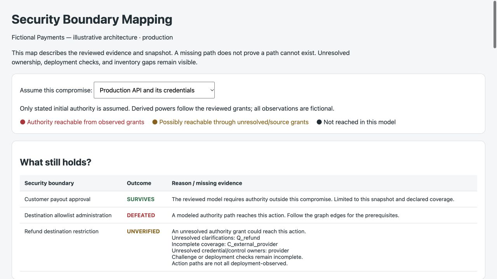

# Security Boundary Mapping


**Map what an attacker can do after each part of your system is compromised, and which protections still hold.**

A model-independent investigation workflow for your coding agent, backed by a dependency-free Python tool. Starts with the entire application: repositories, deployed workloads, credentials, deployment rights, administrators, recovery mechanisms, external providers and consequential operations. You do not need to pick a money route first.

The result is a private, offline interactive authority map, a compromise matrix, a deployment/credential inventory, and targeted questions about missing facts. Select a compromise scenario to see reachable authority and the restrictions that survive, fail, or remain unverified.

## Start one investigation

Requires Python 3.10+ and a coding agent. The package itself needs no model API key or cloud credentials. The agent needs repository access and your existing authenticated, read-only provider tools to inspect deployments.

```sh
git clone https://github.com/samuyoon/security-boundary-mapping.git
cd security-boundary-mapping
python3 boundary_map.py init \
  --name "My application" \
  --repo api=/path/to/api \
  --repo contracts=/path/to/contracts \
  --environment production \
  --out /path/to/private/security-review
```

Give your coding agent this instruction:

> Read `/path/to/private/security-review/RUN.md` and carry out the entire investigation. Discover the system across the supplied repositories and connected read-only deployment tools. Ask me targeted questions about missing ownership, access and recovery facts. Continue independent work while waiting. Reconcile the answers, challenge the authority graph, and deliver the offline visual map. Do not modify the target system or move money.

`init` indexes source-file and environment-variable-name candidates and creates a resumable workspace. **It does not run a model or inspect cloud accounts.** RUN.md instructs your host agent to perform those steps. File names and symbol matches are discovery hints, never established permissions or a completeness claim. No particular agent vendor or autonomous agent runner is required.

## What the agent investigates

1. Discover repositories, services, workers, deployment accounts, contracts, signing systems, providers, and environments.
2. Read actual deployment metadata: deployed revision, workload identities, credential references, effective permissions, and who can deploy, configure, read secrets, impersonate, administer or recover accounts.
3. Build a graph of authority, including indirect paths and multi-party approval requirements. Trace all discovered money/value and administrative operations within that graph.
4. Ask the user about unresolved key holders, administrators, recovery powers, missing accounts and permission evidence. Save answers and reconcile them with observations.
5. Evaluate separate and combined compromises, challenge the claimed separations, and render the map.

Connected-tool availability varies. The package does not contain provider SDKs or silently log into cloud accounts. If the agent lacks read access, it asks for a connection or sanitized metadata export and records the gap. It never needs secret values. The review may take several conversational turns; missing facts remain visibly unverified.

## View and resume

```sh
python3 boundary_map.py questions /path/to/private/security-review/report.json
python3 boundary_map.py answer /path/to/private/security-review/report.json \
  --id Q1 --text "The signing administrator is controlled by two separate hardware-key holders."
# Have the agent reconcile the answer and obtain corroborating evidence.
python3 boundary_map.py validate /path/to/private/security-review/report.json
python3 boundary_map.py render /path/to/private/security-review/report.json \
  --out /path/to/private/security-review/map.html
```

Open `map.html` locally. It is standalone: no network requests, external libraries, or uploads. Repository paths are read from private workspace.json. Supply repeated `--repo ID=/path` arguments when reviewing the example or relocating repositories. Outputs are never silently overwritten.

The CLI's `evidence` command records a selected, non-secret file's hash and line range:

```sh
python3 boundary_map.py evidence --root /path/to/private/security-review \
  --root-id artifacts --path deployment-snapshot.json --start 1 --end 40 --id E1 \
  --kind deployment --captured-at 2026-10-24T12:00:00Z \
  --provenance "Read-only provider metadata; account example; production; collector and limitations recorded in file"
```

## Interpreting the result

| Outcome | Meaning within the reviewed model and snapshot |
| --- | --- |
| **Survives** | The action still requires authority outside this compromise; relevant review, ownership, coverage and deployment checks are resolved. |
| **Defeated** | Observed grants reach the action, including through indirect administrative or recovery authority. This is not automatically a confirmed exploit. |
| **Unverified** | A possible authority path, missing owner, unanswered question, source-only claim or coverage gap prevents a supported conclusion. |

A valid report is not a security certification. The analyzer follows the supplied graph; it cannot prove the agent discovered every component or hidden authority path. It verifies evidence integrity, not provider authenticity. Every report exposes its scope, original capture times, coverage and exclusions.

Keep outputs outside public repositories. Authority maps and metadata can themselves be sensitive. Your hosted agent's data-handling terms still apply.

## Example and implementation



- [Interactive fictional example](examples/fictional-payments/map.html) — download and open locally.
- [Markdown example](examples/fictional-payments/REPORT.md).
- [Report format](REPORT_FORMAT.md), [schema](report.schema.json), and [investigation prompts](prompts/discover.md).
- `boundary_map.py`: source candidate discovery, workspace setup, clarification tracking, evidence validation, fixed-point authority analysis and offline rendering.
- `viewer.html`: selectable compromise scenarios, authority graph, evidence inventory and coverage gaps.

This redesign replaces the former one-operation report format; old reports must be reinvestigated using the system graph. MIT licensed.

```sh
python3 -m unittest discover -s tests -v
python3 boundary_map.py validate examples/fictional-payments/report.json --repo repo1=examples/fictional-payments
```
